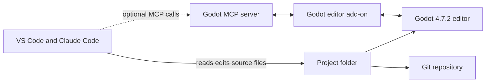

# Windows setup: Godot ↔ Claude Code ↔ optional live-editor MCP

_Last verified against publicly available information on 2026-11-16. Third-party MCP tooling can change; always inspect the project README/release notes before installation._

## Architecture — know what is connected



**Claude does not need MCP to edit this game.** Claude Code can read/write `.gd`, `.tscn`, and `.md` from a working directory. MCP is an **optional** third-party bridge that allows additional direct editor interaction; the Godot and Claude product vendors do not ship this project's MCP by default.

## Part A — Godot 4.7.2

1. Download <https://godotengine.org/download/windows/> (select **Godot 4.7.2**, standard build; avoid Godot 4.8 beta unless your project intentionally upgrades).
2. Extract the Godot executable, e.g. `C:\Tools\Godot\Godot_v4.7.2-stable_win64.exe`.
3. Optionally rename/copy it to `C:\Tools\Godot\godot.exe`, and add `C:\Tools\Godot\` to your user `PATH`. Restart PowerShell/VS Code.
4. Extract this ZIP to `C:\Dev\RallyPop_Pickleball_Godot_Starter`.
5. Launch Godot → **Import** → select `project.godot` → **Import & Edit**.
6. Wait for import. Press **F5** to open the starter menu.
7. Run from terminal once `godot` is in PATH:

```powershell
godot --version
godot --headless --path . --editor --quit
godot --headless --path . --script res://tests/unit/test_rules.gd
```

Or pass the explicit exe path to the included helper:

```powershell
.\tools\validate_project.ps1 -Godot "C:\Tools\Godot\godot.exe"
```

If PowerShell blocks scripts because of execution policy, **do not disable security globally**. Run the two `godot --headless` commands manually, or use a process-only policy with informed consent.

## Part B — Claude Code: simplest connection

**Option 1: VS Code extension**
1. Install VS Code and open the **folder containing `project.godot`** via **File → Open Folder**.
2. In Extensions, install **Claude Code** by Anthropic: <https://marketplace.visualstudio.com/items?itemName=Anthropic.claude-code>.
3. Open the Claude Code panel and sign in with an account that has Claude Code access.
4. Open `CLAUDE.md` and `prompts/MASTER_STARTING_PROMPT.md`. Ask Claude to inspect the repo and run checks before editing files.

**Option 2: Claude Code CLI (PowerShell)**
Install from Anthropic's latest official instructions <https://code.claude.com/docs/en/setup>. A currently documented Windows native command is:

```powershell
irm https://claude.ai/install.ps1 | iex
```

Only execute an internet-fetched installer when you trust the vendor; alternatively use `winget install Anthropic.ClaudeCode` where available. Restart terminal, then:

```powershell
claude --version
cd "C:\Dev\RallyPop_Pickleball_Godot_Starter"
claude
```

Authenticate as prompted. Some Claude Code functionality may require an eligible subscription or API billing. The VS Code extension and CLI installation methods can differ; check Anthropic's docs if the command changed.

**What exactly is connected?** Claude is operating on the **same files Godot imports**. Save a `.gd` file in Claude; return to Godot and it reloads/reimports the file. You generally do not need to manually reattach scripts to scenes because this starter already references them.

## Part C — Optional: install a Godot MCP editor bridge

For a direct Godot-editor MCP workflow, one documented third-party option at the time of writing is **shin2344234/godot-mcp**: <https://github.com/shin2344234/godot-mcp>. It documents Godot 4.7+, Node.js 22+, and a project initialization command. This is **community software**, not a built-in Godot/Anthropic feature. Review its code, permissions, releases, and maintenance before use.

1. **Commit your repository first**, and close any active Claude/Godot editor sessions that could conflict.
2. Install Node.js 22+ from <https://nodejs.org/> and confirm:

```powershell
node --version
npm --version
```

3. In this **same project folder**, run the documented interactive initializer:

```powershell
npx -y @shin2344234/godot-mcp init
```

The initializer should preview its changes and prompt before writing (its README also documents `--dry-run`). Because this executes third-party code, use it only after reviewing the repository, and check that the package is the publisher you intended.

4. The initializer may create `addons/godot_mcp/`, enable the add-on, and configure an MCP client. Inspect **`git diff`** and any configuration changes.
5. Open the project in Godot and check **Project → Project Settings → Plugins** for the added integration; enable it if required by the selected version.
6. Restart Claude Code or its VS Code session. Ask: **"Use your Godot MCP status tool to confirm you're connected to the open RallyPop editor, then list visible scene nodes. Make no changes."**
7. If the integration fails, use normal Claude Code source editing. MCP is optional; the core project does not depend on it.

### Alternative MCP implementations
- <https://github.com/OREBRON/godot-mcp> — Go binary and editor plug-in; see its installation instructions.
- <https://github.com/RimuruDev/godot-mcp> — broader Godot AI tools; supports Godot 4.7+ per its README.

**Don't install multiple competing Godot editor MCP plug-ins at the same time.** This ZIP intentionally does **not** copy third-party MCP binaries, npm packages, or editor add-ons into the project. Install the one you choose yourself after reading the vendor instructions and licenses.

## Part D — Using the files in Godot/Blender

- All Godot source files are already in the root. **Import existing project**, not **Create Project**.
- Open `scenes/game/training.tscn` to inspect the training scene's node tree.
- Double-click `scripts/gameplay/training_game.gd` to inspect the main loop.
- Export a model from Blender as `glTF 2.0 (.glb)` with a consistent rig and applied transforms.
- Copy it to `assets/models/characters/your_character.glb`.
- Return to Godot; allow automatic import; drag the imported character into a **duplicate of** `scenes/player/player.tscn`, replacing only the placeholder `Body` visual while keeping `CharacterBody3D`, collision and controller nodes intact.
- Save as a new scene, test animations and coordinate orientation. Read [docs/08_3D_ASSET_PIPELINE.md](docs/08_3D_ASSET_PIPELINE.md) for the full handoff contract.

## Part E — Typical team collaboration

- Treat GitHub as the source of truth for code and Blender sources.
- Give each coding agent a feature branch and a bounded ticket.
- Do not use Claude Desktop chat alone as a substitute for Claude Code's project-folder access. A web chat cannot change local Godot files without a separate tool/agent workflow.
- Run a headless import/test check after every meaningful merge; then run manual F5 gameplay.
- Keep project-specific secrets out of `.md`, `.tscn`, `.gd`, and Git history.

## Part F — Windows fixes

| Symptom | What to do |
|---|---|
| Godot project doesn't appear | Import `project.godot`, not an empty folder or individual scene. |
| `godot` not recognized | Use the full `.exe` path or add its folder to PATH. |
| `claude` not recognized | Restart terminal; inspect Anthropic's native install PATH instructions. |
| `npm.ps1` cannot be loaded | Use `npm.cmd` / `npx.cmd` from PowerShell, or fix a process-scoped execution policy after reviewing security implications. |
| VS Code Claude reads wrong files | File → Open Folder; select the folder containing `project.godot`. |
| MCP not connected | Verify Node version, Godot plugin enabled, Godot editor open, package versions and client restart. |
| Errors when importing `.glb` | Apply Blender transforms, verify scale/orientation, check unsupported materials/animations. |
| Godot parse error | Stop adding features; ask Claude to fix exact error and rerun headless check. |

## Source of truth
- Godot download: <https://godotengine.org/download/windows/>
- Anthropic Claude Code setup: <https://code.claude.com/docs/en/setup>
- Claude Code VS Code: <https://marketplace.visualstudio.com/items?itemName=Anthropic.claude-code>
- Third-party MCP: <https://github.com/shin2344234/godot-mcp>
