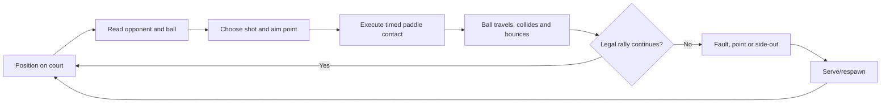

# 01 — Game Design Document (GDD)

## High concept
**RallyPop Pickleball** (working title) is an original stylized third-person sports game built for mouse-and-keyboard competition. The player manually controls a chibi athlete while aiming intended landing spots with a screen-space cursor. It blends authentic court strategy with forgiving readability and responsive animations. Our inspiration is the *general design principle* of cursor-based arcade sports control; art and implementation must be original.

## Design pillars
1. **One-minute readability:** new players understand movement, cursor marker, hit window and scoring.
2. **High skill ceiling:** timing, positioning, anticipation, power, shot selection and mind games matter.
3. **Fair competition:** legal pickleball constraints and consistent authoritative ball behavior.
4. **Expressive identity:** bright courts, readable silhouettes, satisfying sounds, chibi animation.
5. **Incremental delivery:** one reliable court and rally first; networked doubles before ranked features.

## Players, camera and perspective
- Windows PC, mouse/keyboard; controller later after input abstraction.
- Chase/raised court camera looking toward opposing half; zoom, camera-obstruction and comfort settings later.
- Baseline tutorial and visual cross-court aim marker; assist option for casual players.
- Singles is the **first rules-complete mode**; doubles is required for the beta but should be built on the same rules and match-state architecture.

## Core gameplay loop

## Modes
| Mode | First target | Later scope |
|---|---|---|
| Training sandbox | One local player and simple feeder/bot; feedback overlays | Drills and difficulty selection |
| Local singles | Rules-complete match; human or bot | CPU skill levels |
| LAN singles | Two clients + server | Spectators |
| Online private singles | Lobby code, public server, disconnect handling | Regional discovery |
| Doubles | 4 players, side-aware court positions and score calls | Dynamic teamwork and communication |
| Competitive | — | Ranked, seasonal leaderboards, tournaments |

## Shot vocabulary
- **Drive:** faster flatter trajectory, higher margin for passing the net only with a good contact.
- **Dink:** deliberately soft trajectory into the non-volley-zone region.
- **Drop:** reduced speed from deep court toward opponent kitchen.
- **Lob:** high arc that pushes opponents back.
- **Volley:** airborne contact with kitchen position and momentum restrictions.
- **Return:** contact after required bounce for the second shot of the rally.
- **Serve:** rules-regulated contact and diagonal landing with variant-specific constraints.
- **Overhead:** high-contact attack, initially animation-driven classification rather than a different physics engine.

## Player abilities
- Standard movement, sprint with recovery limits, pivot and lunge.
- Cursor target, optional power charge, shot feedback and limited aim assist.
- Shot quality = timing + reach + movement balance + skill modifier; never guarantee perfection.
- Distinct visual and audio tells for early/clean/late contact and faults.

## Rulesets
- **Competitive rules:** official scoring, serve sequence and faults, no arbitrary physics boosters.
- **Arcade rules:** customizable shorter matches and accessibility assists. The essential two-bounce and kitchen mechanic should remain recognizably pickleball.
- Keep both as **data configurations**, not separate rule engines.

## Social and progression (future)
Private lobbies, profiles, cosmetics, emotes, saved replays, ranked ratings and seasonal events are after core multiplayer reliability. Avoid monetization and social features during the vertical slice.

## Accessibility
Rebindable inputs, readable UI scale, optional color-blind distinguishable target markers, volume controls, reduce camera motion, cursor contrast and accessibility assists clearly labeled in competitive modes.

## Acceptance philosophy
A fun rally at realistic court scale is a bigger milestone than 20 menus. Fix gameplay legibility, shot fairness and networking before content expansion.
