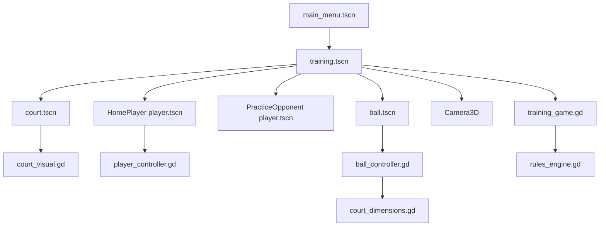
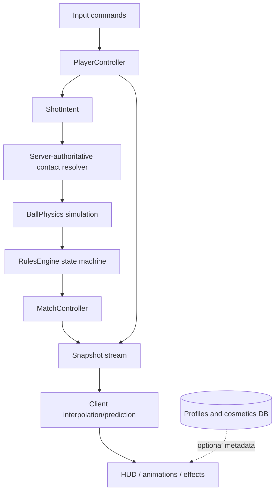

# 02 — Technical architecture & dependency boundaries

## Pinned platform and units
Godot **4.7.2**, GDScript, GL Compatibility for broad PC support in starter, Blender → GLB. Use meters, Y-up, X = court width, Z = court length, **net at z = 0**. Home/player half z positive; opponent z negative. Canonical dimensional constants live in `scripts/core/court_dimensions.gd`.

## Current scene composition

## Target architecture

### Required future modules
- `scripts/core/`: immutable scale/constants, event schema, game configuration and shared data resources.
- `scripts/gameplay/`: local input abstraction, player controller, stamina, hit windows, shot intents, training bot.
- `scripts/physics/`: fixed-step ball integrator, collision detection, trajectory solver, visualization/aim prediction.
- `scripts/rules/`: pure rally adjudication, serve sequence, score state, validated event log and tests.
- `scripts/networking/`: host/server, client, serialization and reconciliation; never make UI the arbiter.
- `scripts/ui/`: present state only; HUD labels must not determine legal events.
- `scripts/animation/`: animation state machine/IK, hit cues and cosmetic presentations.

## Game tick and clocks
Prototype uses Godot `_physics_process()` for fixed-step ball integration. Target 60 physics ticks/second as a starting point; this is a **simulation target**, not an imposed snapshot frequency. In multiplayer the server owns tick IDs, timeouts, ball state and scoring. Handle interpolation on clients; avoid using wall-clock time for physics.

## Message/event schemas (planned)
**InputCommand**: `{match_id, player_id, input_seq, desired_move_2d, aim_world, shot_button, shot_state, client_tick}`.
**ShotIntent**: `{input_seq, server_tick, player_id, requested_shot_type, aim_world, charge_fraction}`.
**BallSnapshot**: `{server_tick, position, velocity, angular_velocity, last_contact_player, rally_id}`.
**RallyEvent**: `{event_id, rally_id, tick, type, contact_player, contact_position, adjudication}`.
**MatchSnapshot**: `{server_tick, mode, serving_team, server_number, score, rally_status, rotation}`.

Messages must use a versioned, validated serialization format; never trust client-declared score, contact success or final shot outcome. The above schemas are a *contract proposal* and have not been implemented.

## Data-driven tuning
**Implemented:** `scripts/core/gameplay_tuning.gd` (`GameplayTuning` resource) with the shipped values in `config/gameplay_tuning.tres`. It covers gravity, shot speeds, flight-time range, bounce, player speeds and movement limits, reach, and the training reset delay. The ball, player and training scripts each expose a `tuning` property that defaults to the shipped file, so a scene can assign a different resource (for example a faster bot). To retune, open the `.tres` in the Godot inspector; values equal to the script defaults are not written to the file. Camera behaviour is data too: `scripts/gameplay/court_camera.gd` (`CourtCamera`) follows a target using a `CameraRig` resource, with `config/camera_training.tres` and `config/camera_match.tres` as the two views. Bot positions are still literals in `training_game.gd`.

Use named `.tres` resources for move speeds, swing windows, camera offsets, target assist, bounce coefficients and match presets. Preserve reproducible defaults under Git. Avoid tuning gameplay by editing unrelated Godot node scripts.

## Maintainability rules
- Ball state can be rendered by any visual; physics does not query UI.
- Rules engine consumes canonical events, not HUD label strings or animations.
- Assets only depend on a stable wrapper interface and skeleton contract.
- Practice bot uses the same input/shot intent path as real players where possible.
- No singleton global mutable scoring state until there is a documented lifecycle.
- Use explicit typed signals; write tests before changing core service/score rules.

## Known technical debt in this scaffold
- Net collision is swept (`scripts/physics/net_collision.gd`), but a hit only ends the rally: no net bounce and no separate post collider.
- No spin, drag, timing quality, shot windows, stamina economy or strict kitchen detection yet.
- Practice opponent is a trivial heuristic, not match AI.
- Rally phases and faults run through `RallyState`/`RallyController`; there is still no serve legality, scoring, rollback or reconciliation.
- Camera rigs assume the home half; an away-side player needs a mirrored rig. No occlusion handling, zoom or settings yet.
- Procedural scene visuals are runtime-generated and not finished art.
