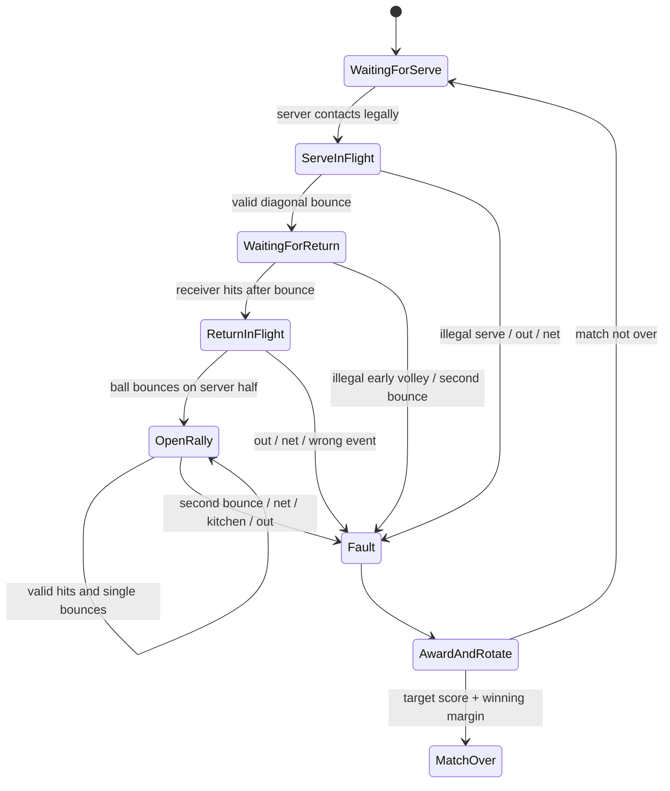

# 05 — Pickleball rules and match state machine

## Authoritative source
Implement the applicable **2026 USA Pickleball Official Rulebook** from <https://usapickleball.org/rules/>. Re-check revisions before tournament/competitive release. This file is a **software implementation plan**, not a replacement for the official rules.

## Geometry
- Court: 20×44 ft = 6.096×13.4112 m, lines inclusive.
- Kitchen/non-volley zone: 7 ft = 2.1336 m from either side of net, with bounding line part of the zone.
- Net height 34 in (0.8636 m) center; 36 in (0.9144 m) at sidelines.
- World origin at net center, X across width, Z along length, Y up.
- Singles and doubles have the same court dimensions; doubles adds server sequence and position bookkeeping.

## Frozen court predicates (implemented and tested)
These live in `scripts/core/court_dimensions.gd` and are pinned by `tests/unit/test_court_dimensions.gd`. Change them only together with that test.

- **Units:** meters. Every dimension is measured to the **outside edge** of its line, and painted lines (2 in = 0.0508 m) sit inside the dimension they mark.
- **Contact point:** predicates take the ball's contact point, meaning its center projected onto the floor. Height is ignored.
- **Handedness:** a player facing -Z has +X on their right. Home (z > 0) faces -Z, so home's right court is +X. Away faces +Z, so away's right court is -X.

| Predicate | True when | Lines |
|---|---|---|
| `inside_court(pos)` | `abs(x) <= 3.048` and `abs(z) <= 6.7056` | Sidelines and baselines are in; 0.1 mm epsilon for 32-bit float rounding only |
| `inside_kitchen(pos)` | inside court and `abs(z) <= 2.1336` | Kitchen line is part of the kitchen |
| `side_from_z(z)` | returns +1 for `z >= 0` (home), -1 otherwise | Net plane counts as home |
| `net_height_at(x)` | 0.8636 at center rising linearly to 0.9144 at the sidelines and beyond | — |
| `legal_serve_target(pos, from_home, from_right)` | inside court, beyond the kitchen, on the receiver's half, in the court diagonal to the server | Kitchen line is a fault; centerline, sideline and baseline are in |

Net posts are 22 ft apart (`NET_HALF_WIDTH` = 3.3528 m). The ball radius (0.105 m) is still the exaggerated prototype value, not regulation.

## Essential predicates
- `landing_in_bounds`: include boundary line as in (physical ball contact vs line geometry to be resolved).
- `served_to_correct_diagonal_service_court`: not kitchen, correct opposite-side service rectangle.
- `two_bounce_condition`: serve must bounce on receiver half; return must bounce on serving half before volleys can occur.
- `kitchen_volley_fault`: volley contact while player touches NVZ or boundary, OR momentum carries them into NVZ in a prohibited way.
- `net_contact_fault`: player or equipment touches the net during live ball when prohibited.
- `ball_double_bounce_fault`: second bounce before a legal return.
- `serve_legality`: choose volley or drop-serve implementation and model correct legal motion/position requirements explicitly.

## Rally state machine (planned)

## Scoring engine
- Implement **traditional side-out scoring** as the competitive default; only serving side scores points.
- Track team/individual scores, current service team, server number (for doubles), player positions, right/left court assignment, first service sequence nuance, win-by-two and score cap/match configuration.
- Do not derive server rotation solely from score without storing team/person state.
- Support rally scoring later as an explicit configurable mode; don't mix with side-out rules.
- Test 0-0-2 doubles start and subsequent first/second server sequence against rulebook, including side-out.

## Player-foot and momentum logic
The kitchen is not forbidden ground. Standing there is allowed; hitting an airborne ball as a volley is illegal when touching NVZ, and the momentum prohibition requires additional state even if feet are outside at contact. Track stance/contact/momentum transitions as validated player events; do not trigger a fault for merely stepping into the zone.

## Test examples
| Scenario | Expected |
|---|---|
| Serve lands on kitchen line | Service fault |
| Legal groundstroke after kitchen bounce while standing in NVZ | Allowed |
| Volley made with player's foot on NVZ line | Fault |
| Volley from outside followed by prohibited momentum into NVZ | Fault |
| Volley of serve return without letting it bounce | Fault |
| Volley of third shot without letting return bounce | Fault |
| Ball touches outer court line | In |
| Team scores while receiving under traditional rules | Side-out rather than point |

## Known starter status
`RulesEngine` has **only helper geometry and diagonal-target predicates**; full serve/scoring state transitions and kitchen/momentum logic are **not implemented**. The practice HUD explicitly avoids claiming official scoring.
