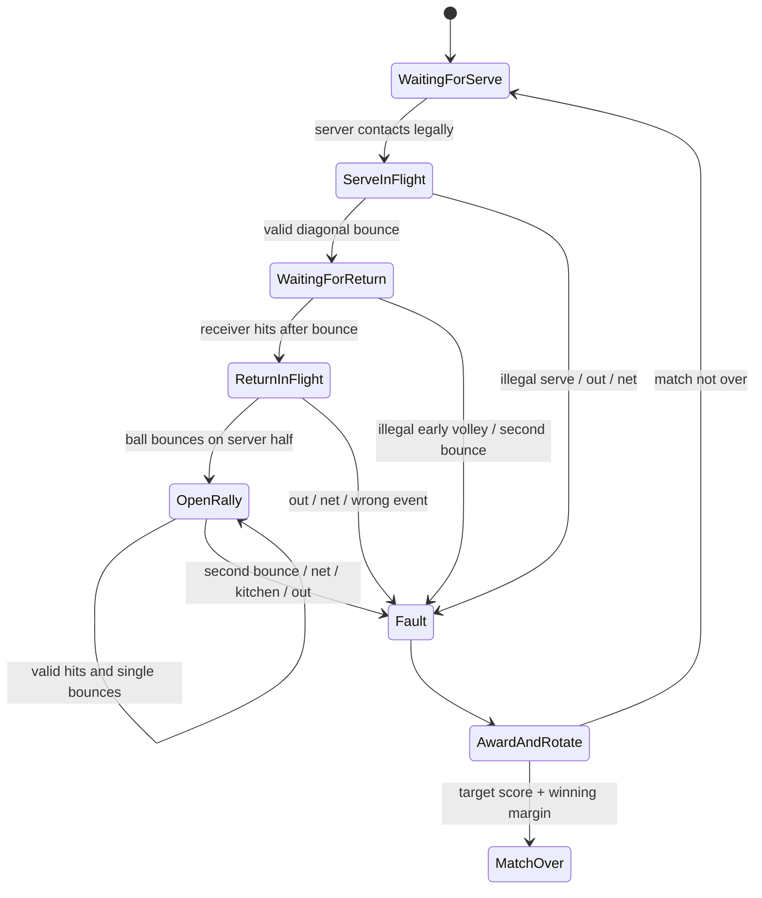

# 05 — Pickleball rules and match state machine

## Authoritative source
Implement the applicable **2026 USA Pickleball Official Rulebook** from <https://usapickleball.org/rules/>. Re-check revisions before tournament/competitive release. This file is a **software implementation plan**, not a replacement for the official rules.

## Geometry
- Court: 20×44 ft = 6.096×13.4112 m, lines inclusive.
- Kitchen/non-volley zone: 7 ft = 2.1336 m from either side of net, with bounding line part of the zone.
- Net height 34 in (0.8636 m) center; 36 in (0.9144 m) at sidelines.
- World origin at net center, X across width, Z along length, Y up.
- Singles and doubles have the same court dimensions; doubles adds server sequence and position bookkeeping.

## Frozen court predicates (implemented and tested)
These live in `scripts/core/court_dimensions.gd` and are pinned by `tests/unit/test_court_dimensions.gd`. Change them only together with that test.

- **Units:** meters. Every dimension is measured to the **outside edge** of its line, and painted lines (2 in = 0.0508 m) sit inside the dimension they mark.
- **Contact point:** predicates take the ball's contact point, meaning its center projected onto the floor. Height is ignored.
- **Handedness:** a player facing -Z has +X on their right. Home (z > 0) faces -Z, so home's right court is +X. Away faces +Z, so away's right court is -X.

| Predicate | True when | Lines |
|---|---|---|
| `inside_court(pos)` | `abs(x) <= 3.048` and `abs(z) <= 6.7056` | Sidelines and baselines are in; 0.1 mm epsilon for 32-bit float rounding only |
| `inside_kitchen(pos)` | inside court and `abs(z) <= 2.1336` | Kitchen line is part of the kitchen |
| `side_from_z(z)` | returns +1 for `z >= 0` (home), -1 otherwise | Net plane counts as home |
| `net_height_at(x)` | 0.8636 at center rising linearly to 0.9144 at the sidelines and beyond | — |
| `legal_serve_target(pos, from_home, from_right)` | inside court, beyond the kitchen, on the receiver's half, in the court diagonal to the server | Kitchen line is a fault; centerline, sideline and baseline are in |

Net posts are 22 ft apart (`NET_HALF_WIDTH` = 3.3528 m). The ball radius (0.105 m) is still the exaggerated prototype value, not regulation.

## Essential predicates
- `landing_in_bounds`: include boundary line as in (physical ball contact vs line geometry to be resolved).
- `served_to_correct_diagonal_service_court`: not kitchen, correct opposite-side service rectangle.
- `two_bounce_condition`: serve must bounce on receiver half; return must bounce on serving half before volleys can occur.
- `kitchen_volley_fault`: volley contact while player touches NVZ or boundary, OR momentum carries them into NVZ in a prohibited way.
- `net_contact_fault`: player or equipment touches the net during live ball when prohibited.
- `ball_double_bounce_fault`: second bounce before a legal return.
- `serve_legality`: choose volley or drop-serve implementation and model correct legal motion/position requirements explicitly.

## Rally state machine (planned)

### Implemented (RP-020)
`scripts/rules/rally_event.gd` defines `RallyEvent` (`id`, `rally_id`, `tick`, `type` = HIT / BOUNCE / NET, `side`, `position`). `scripts/rules/rally_state.gd` (`RallyState`) is the state machine above, without `AwardAndRotate` and `MatchOver`, which belong to scoring (RP-024). It is pure and pinned by `tests/unit/test_rally_state.gd`.

| Fault | Raised when | Charged to |
|---|---|---|
| `NET` | ball is stopped by the net | last hitter |
| `OUT` | bounce outside the court (lines are in) | last hitter |
| `OWN_SIDE` | bounce on the hitter's own half | last hitter |
| `DOUBLE_BOUNCE` | second bounce before a return | side that let it bounce |
| `VOLLEY_BEFORE_BOUNCE` | serve or return hit out of the air | the side that volleyed |
| `DOUBLE_HIT` | same side hits twice in a row | that side |
| `SERVE_POSITION` | server not behind the baseline, or outside the half they serve from | server |
| `SERVE_COURT` | serve lands in the kitchen (line included) or the wrong service court | server |
| `KITCHEN_VOLLEY` | volley hit while the hitter stands in the kitchen, line included | the volleyer |
| `KITCHEN_MOMENTUM` | volleyer steps into the kitchen within the momentum window after a volley | the volleyer |

`apply(event)` returns false and changes nothing for a duplicate or older event id, an event from another rally, anything after the rally has ended, and anything but the server's hit before the serve. So one contact can never end a rally twice.

A ball that has already bounced in once is a double bounce wherever it lands next, including outside the lines.

### Live play (RP-021)
`scripts/gameplay/rally_controller.gd` (`RallyController`) numbers events, stamps them with the physics tick, feeds the current `RallyState` and emits `rally_ended` once. The ball (`scripts/physics/ball_controller.gd`) only reports `bounced(position)` and `net_hit(position)`; it no longer decides faults. In the training scene the player's first hit of each practice ball is the serve, so the two-bounce rule applies: the opponent lets the serve bounce, and the player must let the return bounce. The aim line shows "WAIT" while that return is in the air, and volleying it ends the rally with a two-bounce fault. A second click on your own shot is ignored rather than counted as a double hit.

### Serves (RP-022)
`RallyState` takes `serve_from_right` and checks two things. At the serve hit, `CourtDimensions.legal_serve_position` requires the server's feet behind their baseline (on the line is a foot fault) and between the centerline and sideline extensions of the half they serve from. At the serve's first bounce, `legal_serve_target` requires the diagonal service court. `RallyEvent.player_position` carries the hitter's feet for this.

**Design choice:** every serve is treated as a drop serve, which has no upward-swing, waist-height or paddle-position restrictions, so no swing motion is checked. The drop and its bounce are not simulated; the ball starts in the server's hand. A player is one ground point, not two feet.

In the training scene each new ball puts the player on a legal serve spot in the right court. The aim line reads "SERVE FAULT IF HIT" with the reason when the position or target is illegal; the serve can still be hit and is then called.

### Kitchen and momentum (RP-023)
A volley is a hit made in the open rally before the ball has bounced. `RallyState` checks the hitter's feet (`RallyEvent.player_position`) against `CourtDimensions.inside_kitchen`: in the kitchen or on its line is `KITCHEN_VOLLEY`. Otherwise it remembers the tick of that side's volley. A `KITCHEN_ENTRY` event from the same side within `momentum_ticks` (from `GameplayTuning.momentum_window`, 0.6 s) is `KITCHEN_MOMENTUM`. Any other kitchen entry is ignored and not logged, so walking into the kitchen, standing there, and hitting a ball that has bounced are all allowed. The area beside the court level with the kitchen is not the kitchen.

In the training scene `training_game.gd` reports each step into the kitchen, and the aim line reads "KITCHEN" when a hit would be a volley from inside it.

**Simplifications to revisit:** the real rule has no fixed time; momentum lasts until the player regains balance, and it still applies after the ball is dead. Here it is a fixed window and only while the rally is live. A player is one ground point, so "one foot on the line" and items the player drops or a partner are not modelled. The practice opponent never volleys.

Limits: always the right court, because choosing the side needs the score (RP-024); a serve that clips the net is a fault because the net stops the ball, although the real rule plays it; the rally winner is shown but no points are awarded (RP-024).

## Scoring engine
**Implemented for singles (RP-024):** `scripts/rules/match_score.gd` (`MatchScore`), pinned by `tests/unit/test_match_score.gd`.

- Side-out scoring: `record_rally(rally_id, winner)` gives the server a point when the server won the rally; otherwise it is a side-out, no point, and the receiver becomes the server.
- Serve side: the server serves from their right court when their own score is even, left when odd (`serve_from_right()`).
- Match end: first to `points_to_win` (11) leading by `win_by` (2). An optional `point_cap` ends it at that score whatever the margin. Because only the server scores, a match can only be won on your own serve.
- A rally id is counted once; repeats, older ids and rallies without a winner change nothing. Nothing changes after the match is won.
- `score_call()` gives the score as called: server's points first.

`RallyController.new_match(...)` creates the score; each finished rally is recorded before `rally_ended` fires, `match_ended` fires once, and `start_next()` starts the following rally with the right server and serve side.

Not implemented: doubles (server number, partner positions, the 0-0-2 start), rally scoring as an alternative mode, games per match and end changes, timeouts. The playable training scene does not run a match yet: the player serves every practice ball and no score is kept (RP-025).

- Implement **traditional side-out scoring** as the competitive default; only serving side scores points.
- Track team/individual scores, current service team, server number (for doubles), player positions, right/left court assignment, first service sequence nuance, win-by-two and score cap/match configuration.
- Do not derive server rotation solely from score without storing team/person state.
- Support rally scoring later as an explicit configurable mode; don't mix with side-out rules.
- Test 0-0-2 doubles start and subsequent first/second server sequence against rulebook, including side-out.

## Player-foot and momentum logic
The kitchen is not forbidden ground. Standing there is allowed; hitting an airborne ball as a volley is illegal when touching NVZ, and the momentum prohibition requires additional state even if feet are outside at contact. Track stance/contact/momentum transitions as validated player events; do not trigger a fault for merely stepping into the zone.

## Test examples
| Scenario | Expected |
|---|---|
| Serve lands on kitchen line | Service fault |
| Legal groundstroke after kitchen bounce while standing in NVZ | Allowed |
| Volley made with player's foot on NVZ line | Fault |
| Volley from outside followed by prohibited momentum into NVZ | Fault |
| Volley of serve return without letting it bounce | Fault |
| Volley of third shot without letting return bounce | Fault |
| Ball touches outer court line | In |
| Team scores while receiving under traditional rules | Side-out rather than point |

## Known starter status
`RulesEngine` has helper geometry and diagonal-target predicates. Rally phases and basic faults are in `RallyState` (above). Serve position, service courts and kitchen/momentum faults are in `RallyState` too. Singles scoring is in `MatchScore`; no playable match uses it yet. The practice HUD explicitly avoids claiming official scoring.
