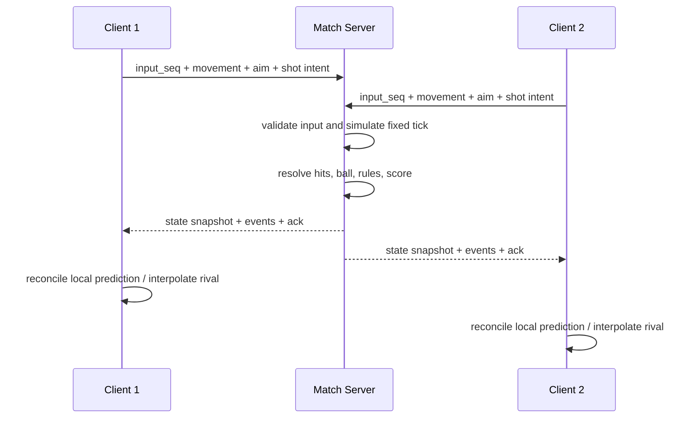

# 06 — Multiplayer architecture and roadmap

## Core choice
Authoritative **dedicated server** running Godot headlessly and owning fixed-tick simulation for all matches. A player may host a LAN test server, but competitive internet matches should run on controlled server infrastructure.

## Why authority matters
Clients can predict their own animation/movement for responsiveness, but must not declare official ball contact, teleport their character, decide faults, write scores or select winners. A server accepts **inputs**, validates intent and broadcasts **snapshots/events**.

## Lifecycle

## Implementation stages
- **N0 Local:** one process, two controllable entities; rules/ball logic isolated from presentation.
- **N1 LAN two-process:** separate server/client build; join/leave, player ownership, snapshots; verify no duplicate scoring.
- **N2 Latency simulation:** 50/100/200 ms RTT, packet loss/jitter tests, input buffering, interpolation, prediction and reconciliation.
- **N3 Online private matches:** region-aware server deployment, lobby codes, server selection, firewall/NAT avoidance through public host; reconnect/timeouts.
- **N4 Four-player doubles:** team assignment, serve order, snapshot scalability, simultaneous collisions.
- **N5 Matchmaking/ranked:** separate service with moderation, anti-cheat signals, persistent match history and rating updates.

## ENet and platform considerations
Godot's high-level ENet networking works for desktop prototypes. ENet is UDP-based; a public server/relay is safer for first internet tests than assuming residential port forwarding. For Steam or console, review platform services and license terms later. Do not build matchmaking or identity providers before matches are robust.

## Traffic and state
- Input packets: per-player signed-in session ID + monotonically increasing sequence + validated movement/aim.
- Server tick: fixed-step canonical ball and player state.
- Snapshot: server tick, positional state, ball motion, event IDs and input acknowledgments.
- Client interpolation: remote actors and presentation only.
- Local prediction: reversible movement model; correction needs smoothing to avoid jarring jumps.
- Swing hit: predicted visual response with server-determined contact and legal outcome.

## Edge cases
Reconnect after temporary disconnect, missing player on serve, rejoin into rally, pause/forfeit, duplicate packet, malicious input spam, drift, shot event ordering, transition from serve to active rally, timeouts, migration (defer), clock synchronization and replay event capture.

## Testing requirements
Launch server and **two separate clients** on localhost/LAN; measure latency and packet loss, check simultaneous swings, disconnects and 100 sequential rallies. Verify no divergent scores or ball states. Repeat with four clients when doubles is enabled.

## Not implemented
The starter includes **no** ENet listeners or active server code. `server/` and `scripts/networking/` are placeholders, not a networked game. Don't call the package multiplayer-ready.
