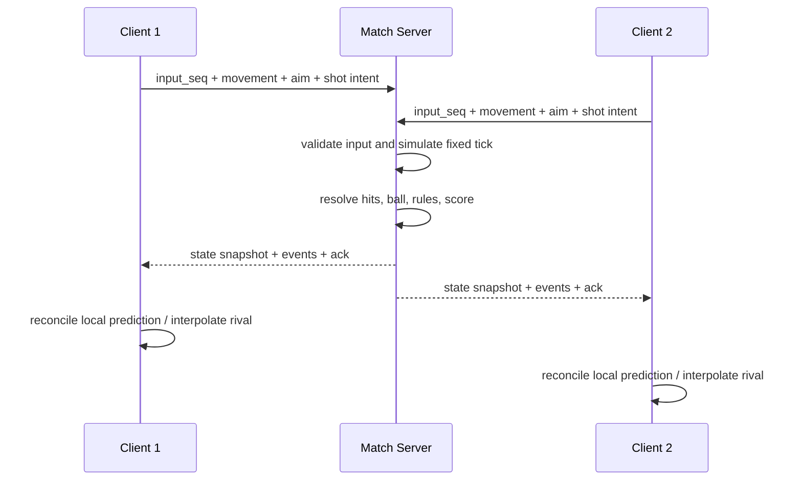

# 06 — Multiplayer architecture and roadmap

## Core choice
Authoritative **dedicated server** running Godot headlessly and owning fixed-tick simulation for all matches. A player may host a LAN test server, but competitive internet matches should run on controlled server infrastructure.

## Why authority matters
Clients can predict their own animation/movement for responsiveness, but must not declare official ball contact, teleport their character, decide faults, write scores or select winners. A server accepts **inputs**, validates intent and broadcasts **snapshots/events**.

## Lifecycle

## Implementation stages
- **N0 Local:** one process, two controllable entities; rules/ball logic isolated from presentation.
- **N1 LAN two-process:** separate server/client build; join/leave, player ownership, snapshots; verify no duplicate scoring.
- **N2 Latency simulation:** 50/100/200 ms RTT, packet loss/jitter tests, input buffering, interpolation, prediction and reconciliation.
- **N3 Online private matches:** region-aware server deployment, lobby codes, server selection, firewall/NAT avoidance through public host; reconnect/timeouts.
- **N4 Four-player doubles:** team assignment, serve order, snapshot scalability, simultaneous collisions.
- **N5 Matchmaking/ranked:** separate service with moderation, anti-cheat signals, persistent match history and rating updates.

## ENet and platform considerations
Godot's high-level ENet networking works for desktop prototypes. ENet is UDP-based; a public server/relay is safer for first internet tests than assuming residential port forwarding. For Steam or console, review platform services and license terms later. Do not build matchmaking or identity providers before matches are robust.

## Traffic and state
- Input packets: per-player signed-in session ID + monotonically increasing sequence + validated movement/aim.
- Server tick: fixed-step canonical ball and player state.
- Snapshot: server tick, positional state, ball motion, event IDs and input acknowledgments.
- Client interpolation: remote actors and presentation only.
- Local prediction: reversible movement model; correction needs smoothing to avoid jarring jumps.
- Swing hit: predicted visual response with server-determined contact and legal outcome.

## Edge cases
Reconnect after temporary disconnect, missing player on serve, rejoin into rally, pause/forfeit, duplicate packet, malicious input spam, drift, shot event ordering, transition from serve to active rally, timeouts, migration (defer), clock synchronization and replay event capture.

## Testing requirements
Launch server and **two separate clients** on localhost/LAN; measure latency and packet loss, check simultaneous swings, disconnects and 100 sequential rallies. Verify no divergent scores or ball states. Repeat with four clients when doubles is enabled.

## Implemented: LAN singles slice (RP-030 to RP-033)
Stages N0 and N1 above are built; N2 exists only as unit tests with simulated conditions. Nothing here has been run between two physical machines.

### Pieces
| File | Role |
|---|---|
| `scripts/gameplay/match_simulation.gd` | The whole match as a pure fixed-tick simulation (60 Hz). The server's single source of truth |
| `scripts/networking/net_protocol.gd` | Wire format and validation. Protocol version 1 |
| `scripts/networking/net_link.gd` | The one node with RPCs; same path (`NetGame/NetLink`) on server and clients |
| `scripts/networking/match_server.gd` | Authority: seats, input ownership and limits, ticking, snapshots, events |
| `scripts/networking/server_main.gd`, `scenes/server/match_server.tscn` | Headless server entry point |
| `scripts/networking/match_client.gd` | Client connection: sends inputs, predicts self, buffers snapshots |
| `scripts/networking/client_prediction.gd` | Local movement prediction and reconciliation |
| `scripts/networking/snapshot_interpolator.gd` | Draws opponent and ball a fixed delay in the past |
| `scripts/networking/online_match.gd`, `scenes/game/online_match.tscn` | The playable online match |
| `scripts/networking/net_config.gd` | Address, port and options from the menu or command line |

### Messages
| Direction | Message | Delivery | Content |
|---|---|---|---|
| client to server | `hello` | reliable | protocol version, seat ticket ("" for a new player) |
| client to server | `submit_input` | unreliable, ordered | match id, sequence number, move vector, sprint, swing type, aim point |
| server to client | `welcome` | reliable | protocol version (2), match id, your side, tick rate, points to win, win by, your seat ticket |
| server to client | `refused` | reliable | why you get no seat: other version, or server full; the connection is closed half a second later |
| server to client | `snapshot` | unreliable, ordered, every 2 ticks | match id, server tick, last input applied for you, both positions, ball position and velocity, score, server, rally id and phase |
| server to client | `game_event` | reliable | numbered: rally started, swing result, rally ended (fault, who, winner, score), match ended, match aborted, opponent away (seconds the match waits), opponent back |

### Timeouts and reconnect (RP-034)
- ENet timeouts are set to notice a silent peer in 3 to 6 s on both ends.
- When a seated player drops mid-match, the server keeps their seat for 20 s and the whole match stands still; the other player is told. If nobody shows that seat's ticket in time, the match is aborted and the other player waits for a new opponent.
- The client, on losing a seated connection, retries every 2 s for 20 s, sending its ticket. Back in the same match it says so and carries on; otherwise it reports the loss and offers the menu.
- A ticket also replaces a connection the server still thinks is alive, because the client can notice a dead link first.
- Serve clock: a server who has not served after 15 s loses the rally (fault `SERVE_CLOCK`). Off in local play.

A swing is a request. The server judges reach and timing from its own state, solves the shot, and announces the result. A refused swing is reported only to the player who swung, at most once per quarter second.

### How a tick works on the server
For each seated player it applies queued inputs while that player has budget (one unit per tick, up to four saved), then advances the world one tick, then every second tick sends each player a snapshot with their own acknowledged sequence number. A player is moved exactly once per input they sent, so an honest client's prediction matches the server exactly; the budget stops anyone from sending inputs faster than real time.

### How the client draws
Its own player: predicted immediately, corrected on each snapshot by replaying unacknowledged inputs; corrections under 1.5 m are blended, larger ones (being placed on the serve spot) are shown at once. The opponent and ball: interpolated 4 ticks (about 67 ms) behind the newest snapshot, never extrapolated. The aim hints use the newest snapshot, so the arc can start a few centimetres from the drawn ball.

### Running it
`tools/run_server.ps1` (or `.sh`) starts the server; options `-Port`, `-Points`, `-WinBy`, `-Bot`, `-Code`. It prints the private match code (made up with `Crypto` unless given: 6 characters, no O/0/I/1). Players join from the main menu with `address:port` and the code; `hello` carries the code, and a wrong one gets `refused` (protocol version 3). After a match the same players are put into a rematch 10 seconds later. If a player leaves, the match is aborted and the other waits for a new opponent.

### Verified, and how
- Unit tests without sockets: protocol (34 checks), server authority and limits (32), prediction and interpolation under simulated latency, loss and bursts (32).
- `tests/integration/test_lan_match.gd`: server and two clients over UDP on localhost in one process; bots play a match; both clients must agree with the server on every rally and the final score; a third client is told the server is full; malformed input is turned away; after the rematch starts, a client's link is cut, the server keeps the seat, and the client reconnects into the same match (33 checks).
- `tools/lan_smoke_test`: the same as three separate processes. Run on 2026-11-17: both scripts passed, with the server and both clients reporting the same final score and zero rejected inputs.

### Known limits
- One match per server process, so one code per process; no lobby service that maps a code to a server, no spectators, singles only.

### Public server deployment: proposal, not built (RP-035)
This needs a human decision because it costs money and puts a port on the internet. Proposed first step:
1. One small Linux VM (any provider, about 5 USD a month) running the headless server from a Linux export, as a systemd service, UDP 7777 open, one process per match on consecutive ports.
2. Before that port is public: a token check on `hello` from a tiny lobby service, a per-address connection rate limit, and DTLS on the ENet link (Godot supports it) so seat tickets and codes are not readable on the wire.
3. A lobby service (HTTP) that creates a match, starts a server process, and returns address plus code; the client then joins as today.
Until those are approved and built, keep the server on a trusted LAN.
- Reconnect works only while the same server process is running; a restarted server has forgotten every seat. A dead link cannot be produced on localhost, so the socket test cuts it by closing the client's socket.
- No accounts, tokens or encryption. Trusted LAN only (see `docs/13_SECURITY_AND_BACKEND.md`).
- Inputs are sent once each, unreliably; a lost input costs one tick of movement and a small correction. No redundancy yet.
- The ball is interpolated, not predicted, so your own hit appears to leave the paddle one round trip plus about 67 ms late.
- No latency, jitter or loss simulator is wired into the running game, and nothing has been measured on a real network.
- Clocks are not synchronised beyond easing the render clock toward the snapshot stream.
- Players are not told where their shot landed online (the landing dot is local-match only).
