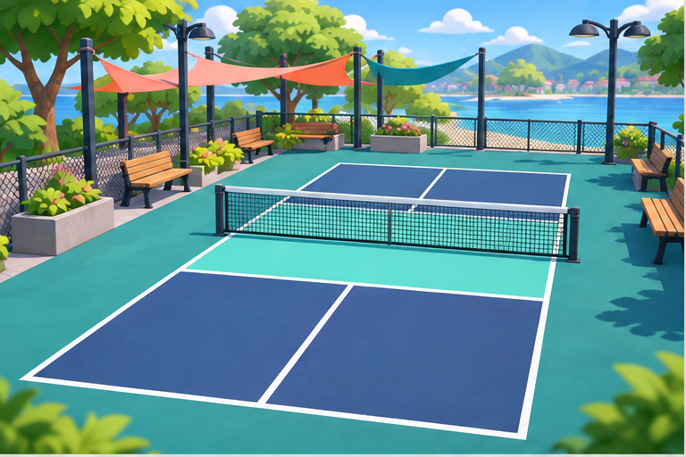
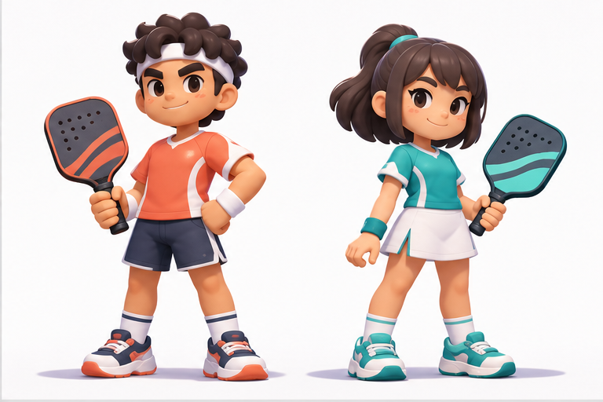
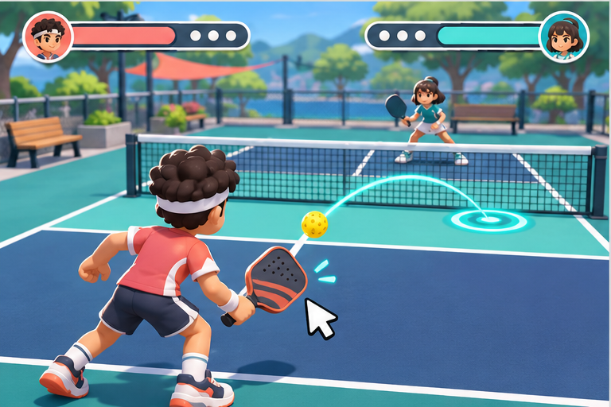
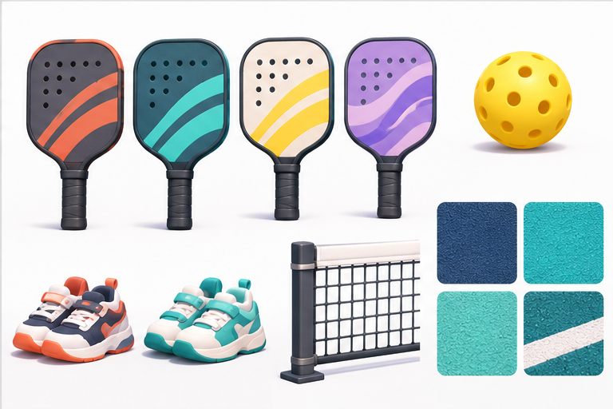

# 15 — Image reference catalog

This pack contains **original generated direction art**, not third-party game screenshots and not game-ready textures. Reference images live under `references/` and are visible in Godot FileSystem but intended to be viewed in VS Code/image viewers.

## Concept art

**01 Court environment:** bright park/waterfront court, net, spectator seating, shade and palette. Rebuild as original meshes; verify real court lines independently.

**02 Characters:** two stylized chibi pickleball player concepts. They are artwork, **not** exact orthographic turnarounds or reusable rigs.

**03 Gameplay:** chase camera, ball highlight, trajectory and aim marker, simplified top HUD. Treat visible UI as directional rather than exact final interface.

**04 Equipment:** original paddle, shoe, ball, net and material ideas.

## Technical diagrams
- `references/technical/court_dimensions.svg` (and `.png`) — to-scale-ish vector callouts for court layout; numeric source is court spec, not exact graphical scale.
- `references/technical/cursor_shot_flow.svg` (and `.png`) — mouse target → shot solver → ball → rules pipeline.
- `references/technical/system_architecture.svg` (and `.png`) — client/server responsibilities.
- `references/technical/color_palette.svg` (and `.png`) — reusable color spec.

## Originality and fidelity
Generated images can misrepresent precise regulation dimensions. Use `docs/05_PICKLEBALL_RULES.md` and USA Pickleball's official rulebook for real values; use `docs/07_ART_DIRECTION.md` for art direction. Model final content independently in Blender.
